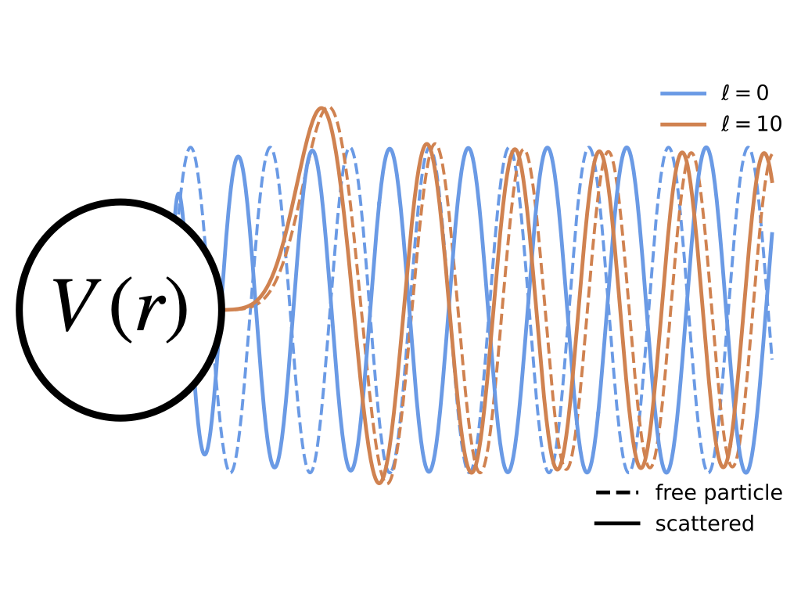

# pykawa

  

The phase shifts and scattering cross sections for Yukawa potentials. 

Solutions are obtained following the variable phase approach. The mathematica scripts used to compute the cross sections can be found in the "mathematica_scripts" directory. 

## Features

See the notebooks for example usage. 
- Load precomputed solutions for the scattering cross section, including the angle-dependent, total, momentum, and viscosity cross sections, for Yukawa potentials in the Born and semi-classical regime. Solutions include both repulsive and attractive (resonant) cross sections
- Use interpolators to obtain solutions across a range of parameter space
- Compute thermally averaged cross sections relevant for structure formation

## Author

pykawa was created in 2026 by Daniel Gilman.

Built with [Cookiecutter](https://github.com/cookiecutter/cookiecutter) and the [audreyfeldroy/cookiecutter-pypackage](https://github.com/audreyfeldroy/cookiecutter-pypackage) project template.

## Attribution 
When using cross sections loaded following the attractive/repulsive_yukawa_tabulated notebooks, link to this repository. 

When using the SIDM cross section class referred to as FERMION_SCALAR_DILEPTON in the cross_section_interpolator module, please cite: 
M. M. Flores, K. Petraki, and T. Pignard, Variable-phase methods and data for long-range scattering, arXiv:2610.30261.

and also cite the dataset:

M. M. Flores, K. Petraki, and T. Pignard, YukawaVPS data: phase shifts, Sommerfeld factors, and cross sections for Yukawa scattering, Zenodo (2026), doi:10.5281/zenodo.23475703.
